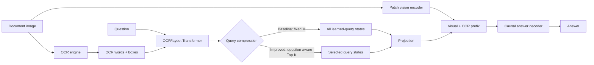

# DocVLM: Efficient Document Reading with Adaptive Queries

> A runnable, local research implementation inspired by **DocVLM: Make Your VLM an Efficient Reader** (CVPR 2025).

<p align="center">
  <a href="#-interactive-overview">Interactive overview</a> |
  <a href="#-quick-start">Quick start</a> |
  <a href="#-baseline-vs-improved">Baseline vs improved</a> |
  <a href="#-reproducibility-and-limitations">Limitations</a>
</p>

## What this project does

Document question answering (DocVQA) asks a model to answer a question about a
document image. A document contains more text and layout information than a
vision-language model should need to read repeatedly. This project explores a
compact representation:

1. Encode document pixels as visual patch tokens.
2. Encode OCR words, their 2D coordinates, the question, and learned queries.
3. Keep a small set of query states as an OCR/layout summary.
4. Project that summary into the decoder space and concatenate it with visual tokens.
5. Generate the answer autoregressively.

The project contains two directly runnable variants:

- **Baseline:** keeps a fixed number of learned query states.
- **Improved:** scores query states using the question and keeps only the
  question-relevant Top-K states.

The improved model is an engineering research hypothesis, not a claim that the
published paper's results have been reproduced.

## 🔎 Interactive overview

<details open>
<summary><strong>See the end-to-end data flow</strong></summary>



<details>
<summary><strong>What is shared and what changes?</strong></summary>

Both variants share the OCR/layout encoder, vision encoder, projection layer,
decoder, tokenizer, data format, and inference runner. The only intended model
change is the compression step:

- Baseline: `M` learned query states are always retained.
- Improved: candidate states are scored against pooled question features,
  Top-K indices are selected, and the selected states are score-gated.

</details>

<details>
<summary><strong>Where to read the implementation</strong></summary>

| Responsibility | File |
|---|---|
| OCR words, boxes, instruction, learned queries | [`src/models/document_encoder.py`](src/models/document_encoder.py) |
| Visual patch tokens | [`src/models/vision_encoder.py`](src/models/vision_encoder.py) |
| Fixed/adaptive fusion model | [`src/models/model.py`](src/models/model.py) |
| Question-aware Top-K selector | [`src/models/adaptive_query_compression.py`](src/models/adaptive_query_compression.py) |
| Projection into decoder space | [`src/models/heads.py`](src/models/heads.py) |
| Causal answer decoder | [`src/models/text_encoder.py`](src/models/text_encoder.py) |
| JSONL dataset and collation | [`src/data/`](src/data/) |
| Training and checkpointing | [`src/training/`](src/training/), [`src/utils/checkpoint.py`](src/utils/checkpoint.py) |
| Baseline wrapper | [`baseline/model.py`](baseline/model.py) |
| Improved wrapper | [`improved/model.py`](improved/model.py) |

</details>

</details>

## ✨ Baseline vs improved

| Dimension | Baseline / fixed-query model | Improved / adaptive-query model |
|---|---|---|
| Purpose | Paper-style structural reference | Proposed efficiency extension |
| OCR input | Same OCR words and normalized boxes | Same |
| Question input | Encoded with the OCR/layout sequence | Encoded with the OCR/layout sequence and used by the selector |
| Candidate queries | `num_queries` learned queries | Up to `max_queries` learned queries |
| Compression | Retains every learned-query output | Scores every candidate and retains `adaptive_k` Top-K states |
| Selection signal | None | Dot-product compatibility between question and query projections |
| Selected queries in default demo | 64 | 16 |
| Visual encoder | Shared local patch encoder | Shared local patch encoder |
| Projection | Shared `VLMProjection` | Shared `VLMProjection` |
| Answer decoder | Shared local causal decoder | Shared local causal decoder |
| Default total prefix | 16 visual + 64 OCR = 80 tokens | 16 visual + 16 OCR = 32 tokens |
| Expected efficiency | Larger OCR prefix | Smaller OCR prefix and potentially lower decoder work |
| Accuracy status | No meaningful local accuracy result | No meaningful local accuracy result |
| Scientific interpretation | Structural baseline only | Hypothesis requiring controlled evaluation |

### Why adaptive selection may help

The baseline sends the same number of OCR summary tokens to the decoder for
every question. The improved path first uses the question to rank candidate
query states, so the decoder receives a smaller question-conditioned summary.
This can reduce prefix length and may improve efficiency, but Top-K selection can
also discard useful information. Only a real-data accuracy/latency ablation can
determine whether the trade-off is beneficial.

## 🚀 Quick start

### 1. Install dependencies

```bash
python3 -m pip install -r requirements.txt
python3 scripts/setup_check.py
```

The code supports CPU, Apple MPS, and CUDA through the device helper. The local
debug configuration is intentionally small.

### 2. Generate a reproducible synthetic dataset

```bash
python3 scripts/generate_synthetic_data.py --samples 24
```

### 3. Run the integration smoke test

```bash
python3 scripts/smoke_test.py
```

The smoke test exercises data loading, collation, forward/backward passes,
optimizer updates, validation, and checkpoint creation.

### 4. Train the local model

```bash
python3 scripts/train.py --config configs/debug.yaml
```

The best local checkpoint is written to `checkpoints/best.pt`.

### 5. Compare both variants interactively

```bash
python3 run_baseline.py \
  --image data/synthetic/0000.png \
  --question "What is the total amount?"

python3 run_improved.py \
  --image data/synthetic/0000.png \
  --question "What is the total amount?"

python3 compare_models.py \
  --image data/synthetic/0000.png \
  --question "What is the total amount?"
```

The comparison reports selected query counts, prefix-token counts, latency,
Python allocation peak, and decoded text. Timings vary by machine and the
synthetic checkpoint's decoded answers are not meaningful benchmark results.

## 🧩 Repository guide

```text
configs/                 Local, debug, and paper-reference configurations
data/processed/          JSONL train/validation/test manifests
data/synthetic/          Generated document images
scripts/                 Data, OCR, training, inference, and benchmark CLIs
src/data/                Dataset, transforms, vocabulary, and collation
src/models/              Vision, OCR/layout, compression, projection, decoder
src/losses/              Autoregressive cross-entropy
src/training/            Optimizer, scheduler, and trainer
src/utils/               Configuration, devices, seeds, logging, checkpoints
baseline/                Fixed-query wrapper
improved/                Adaptive-query wrapper
outputs/                 Benchmark, metric, prediction, and visualization output
```

## 🧪 Benchmarking query efficiency

Measure local token and latency behavior for several query counts:

```bash
python3 scripts/benchmark_queries.py \
  --config configs/local_debug.yaml \
  --queries 8,16,32
```

Results are saved under
`outputs/benchmarks/query_efficiency/query_efficiency.csv` and `.json`.
These are local CPU/MPS measurements, not published benchmark scores.

## 📄 Real-data input format

Each JSONL record uses image paths relative to `data/` and OCR boxes in the
`0–1000` coordinate range:

```json
{
  "id": "example-001",
  "image": "raw/example.png",
  "question": "What is the invoice total?",
  "answers": ["125.00"],
  "ocr_tokens": ["INVOICE", "TOTAL", "125.00"],
  "ocr_boxes": [[0, 0, 250, 80], [50, 600, 250, 700], [300, 600, 500, 700]]
}
```

Prepare a compatible manifest with:

```bash
python3 scripts/prepare_data.py \
  --input /path/to/train.jsonl \
  --output data/processed/train.jsonl
```

Tesseract is an optional OCR backend:

```bash
python3 scripts/run_ocr.py \
  --input document.png \
  --output document_ocr.json
```

## ⚙️ Configuration

- [`configs/debug.yaml`](configs/debug.yaml): small local integration run.
- [`configs/baseline.yaml`](configs/baseline.yaml): fixed-query comparison path.
- [`configs/improved.yaml`](configs/improved.yaml): adaptive selection path.
- [`configs/local_debug.yaml`](configs/local_debug.yaml): local adaptive
  benchmarking/inference configuration.
- [`configs/paper.yaml`](configs/paper.yaml): documented paper-scale settings,
  not a local recipe.

## 🔬 Reproducibility and limitations

This section separates the implementation's structural scope from claims that
would require paper-scale data, weights, and compute.

### Structurally reproduced

- OCR text plus normalized 2D layout embeddings.
- Instruction/question tokens and learned query tokens in one encoder.
- Retention of learned-query output states.
- Projection into the decoder's hidden dimension.
- Fusion of visual and OCR-derived prefix tokens.
- Autoregressive answer loss and local training/checkpoint plumbing.

### Not reproduced

The published system uses a pretrained 344M-parameter DocFormerV2 encoder,
frozen multi-billion-parameter VLMs such as LLaVA-OneVision, InternVL2, or
Qwen2-VL, licensed benchmark datasets, and large two-stage training runs.
This repository instead uses small local Transformer/vision/decoder modules,
synthetic data, and local configurations. Therefore its losses, decoded text,
latency, and token counts must not be presented as paper-level results.

See [`PAPER_UNDERSTANDING.md`](PAPER_UNDERSTANDING.md),
[`PAPER_TO_CODE_MAPPING.md`](PAPER_TO_CODE_MAPPING.md),
[`FINAL_IMPLEMENTATION_STATUS.md`](FINAL_IMPLEMENTATION_STATUS.md), and
[`REPRODUCIBILITY.md`](REPRODUCIBILITY.md) for the detailed research boundary.

## ✅ Validation status

The intended validation command is:

```bash
python3 scripts/setup_check.py && python3 scripts/smoke_test.py
```

It validates pipeline health, not DocVQA accuracy. A fair baseline/improved
experiment still requires the same dataset, OCR, backbone, checkpoint budget,
random seeds, and evaluation metric for both variants.

## 📚 Further reading

- [`DEMO_GUIDE.md`](DEMO_GUIDE.md): presentation and comparison walkthrough.
- [`BASELINE_VS_IMPROVED.md`](BASELINE_VS_IMPROVED.md): concise architecture diff.
- [`EXPERIMENTS.md`](EXPERIMENTS.md): local measurement interpretation.
- [`CURRENT_ARCHITECTURE.md`](CURRENT_ARCHITECTURE.md): architecture audit.
- [`gas_faclity.pdf`](gas_faclity.pdf): project reference material.
- [`paper/DocVLM.pdf`](paper/DocVLM.pdf): included paper reference.

## Citation

```bibtex
@InProceedings{Nacson_2025_CVPR,
  author    = {Nacson, Mor Shpigel and Aberdam, Aviad and Ganz, Roy and
               Ben Avraham, Elad and Golts, Alona and Kittenplon, Yair and
               Mazor, Shai and Litman, Ron},
  title     = {DocVLM: Make Your VLM an Efficient Reader},
  booktitle = {Proceedings of the IEEE/CVF Conference on Computer Vision and
               Pattern Recognition},
  year      = {2025},
  pages     = {29005--29015}
}
```

## License and data

No license or external benchmark data is bundled by this repository. Add a
license before redistribution and follow the licenses of any datasets,
pretrained weights, OCR engines, or paper materials you provide separately.
